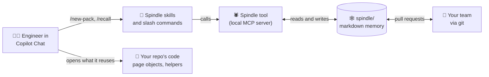

<div align="center">

<picture>
  <source media="(prefers-color-scheme: dark)" srcset="assets/banner-dark.svg">
  
</picture>

**Your AI assistant remembers what your team already built, fixed and learned, so every new test pack starts from experience instead of from scratch.**

[](CHANGELOG.md)
[](LICENSE)
[](#-quick-start)
[](#-why-its-different)
[](tests)
[](#-roadmap)

[](#-supported-today)
[](#-supported-today)
[](#-supported-today)
[](#-how-it-works)

[Quick start](#-quick-start) · [Features](#-features) · [How it works](#-how-it-works) · [Roadmap](#-roadmap) · [Changelog](CHANGELOG.md) · [Full guide](docs/vscode.md)

</div>

---

## 🎯 The problem

Test automation teams solve the same problems again and again:

- 🔁 A new test pack starts from a blank page, even though the team already has page objects, helpers and fixtures that do the job.
- 🧠 The fix for last month's flaky test lives in one engineer's head, or in a PR nobody will find.
- 🤖 AI assistants write tests fast, but they forget everything between sessions and quietly reinvent helpers you already have.
- ⏱️ Under pressure, "fixes" like a 5-second sleep or a deleted assertion slip in and get copied.
- 📦 When the team moves to a new client or project, all that know-how stays behind.

## 💡 What Spindle does

Spindle gives your automation repo a **memory that Copilot reads before it writes a single line of test code**, and keeps adding to as the team works.

- 🕸️ **Remembers** your framework conventions, applications under test, environments, patterns, gotchas and past packs, as plain markdown in your repo.
- 🔎 **Finds what you already have.** It catalogues every reusable function, page object and fixture, so Copilot reuses them instead of writing duplicates.
- 🩹 **Turns errors into answers.** Paste a failure message, and Spindle shows the fix the team recorded last time.
- 🛡️ **Protects you from bad habits.** Shortcuts like sleeps, `force: true` or removed assertions are stored as warnings, never as guidance.
- 🧳 **Travels with you.** Export what you learned as a scrubbed kit and import it into the next project.

> No vector database. No server to host. No dependencies. Just Python 3.8+ and files you own and review in pull requests.

---

## ✨ Features

| | Feature | What it means for you |
|---|---|---|
| 🌾 | **Harvest** | Scans an existing automation repo (no code is run) and builds the first memory: stack, layout, conventions, tags, retries, CI, skipped tests. |
| 📚 | **Capability catalogue** | Lists every exported function, class, method and fixture with its doc comment, so complex helpers get found even if nobody wrote them down. |
| 🎯 | **Ranked matching with reasons** | Describe a scenario in plain words. You get the patterns, gotchas and code that apply, and *why* each one matched. |
| 🏷️ | **"Use when" triggers** | Patterns carry the words people actually use, so "two-step login" finds your OTP helper even if nobody typed "OTP". |
| 🩹 | **Paste an error, get the fix** | Gotchas store the error they fix. The same error, even with different timeouts, brings back the recorded fix first. |
| 🧪 | **Pack builder** | `/new-pack` plans a new test pack from memory, reusing your page objects and helpers, then writes it in your team's style. |
| 🚫 | **Shortcut detection** | Sleeps, `force`, raised timeouts, extra retries, removed assertions and swallowed errors are stored as `avoid`, never as advice. |
| 🔐 | **Secret removal** | Keys, tokens, passwords, connection strings, e-mail addresses, URLs and hosts are stripped on every write, import and export. |
| 💬 | **Prompts to remember** | Copilot offers to save what it learned at the right moments. A commit reminder and a PR checkbox catch the rest. |
| 🧳 | **Memory kits** | Export reusable knowledge as a client-scrubbed zip and import it into another project in one command. |
| ⚖️ | **Governed mode** *(optional)* | Patterns start as candidates and need evidence plus a named approver. AI agents can't approve anything. |
| 📈 | **Efficacy tracking** | Copilot records when a pattern was used, helped or was wrong. Spindle shows which patterns earn their place and proposes the ones to retire. |
| 🔖 | **Memory stamp** | A short version hash of the memory for PR notes, so you always know what a pack was built from. |
| ✅ | **Evals and CI** | Test cases prove search still finds what it should. One command runs structure checks, the secret scan and evals in CI. |

---

## 🧭 How it works



1. **Install** Spindle into your automation repo with one command.
2. **Harvest** the repo once to build the first memory and the code catalogue.
3. **Work as usual.** Before writing a test, Copilot checks memory for patterns, gotchas and reusable code. After the task, it offers to remember what's new.
4. **Share through git.** Memory changes go through pull requests like code, so the whole team gets them on the next pull.

The memory is a folder of plain markdown next to your code:

```text
spindle/
├── index.md            one line per thread, generated
├── catalogue.md        reusable functions, classes and fixtures (from harvest)
├── evals.json          retrieval test cases (optional)
└── threads/
    ├── framework/      conventions, layout, reusable assets
    ├── app/            each application under test: environments, data, gotchas
    ├── pack/           each test pack delivered: scope, coverage, defects found
    └── pattern/        reusable techniques, with "use when" words
```

Each fact is one dated line you can read, review and edit:

```text
- 2026-09-02 [gotcha by:ravi] Evidence upload stalls in SIT. Fix: ClaimsPage.uploadEvidence waits for the scan status error:"locator.setInputFiles: Timeout 30000ms exceeded"
```

---

## 🎬 See it in action

Paste an error into Copilot Chat. Spindle answers with the known fix, the patterns that apply, what *not* to do, and the code you already have:

```text
Known errors:
  claims-portal: Evidence upload stalls in SIT. Fix: ClaimsPage.uploadEvidence waits for the scan status

Memory that applies:
  [pattern] file-upload: File upload  score 7: use when 'upload'; use when 'evidence'
      Uploads: setInputFiles on the upload input, then wait for the scan status text

Avoid (shortcuts recorded before; they hide the problem, don't repeat them):
  claims-portal: Upload flaky on Fridays. Fix: added waitForTimeout(8000) before submit

Code you can reuse:
  pages/ClaimsPage.ts :: ClaimsPage.uploadEvidence(filePath): Uploads an evidence file and waits for the virus scan to finish
```

---

## ✅ Supported today

Spindle 0.5 focuses on one stack and does it well:

| | Supported now |
|---|---|
| 🎭 **Framework** | Playwright (TypeScript / JavaScript) |
| 🤖 **AI assistant** | GitHub Copilot in **Agent** mode |
| 🖥️ **IDE** | Visual Studio Code |
| 🐍 **Runtime** | Python 3.8+ on Windows, macOS or Linux |

Harvest can already read Cypress, Selenium, WebdriverIO, pytest, Robot Framework, REST Assured and SpecFlow repos, but they aren't officially supported yet.

---

## 🚀 Quick start

**1. Get Spindle**

```bash
git clone https://github.com/AbhiAuto/Spindle.git
```

**2. Install it into your Playwright repo**

```bash
# macOS / Linux
python3 Spindle/install_vscode.py path/to/your-playwright-repo --name "Your QA team"

# Windows
python Spindle\install_vscode.py path\to\your-playwright-repo --name "Your QA team"
```

Optional flags: `--governed` (patterns need evidence and an approver) and `--ci` (adds a GitHub Actions check).

**3. Open the repo in VS Code**, start the `spindle` MCP server from `.vscode/mcp.json`, and switch Copilot Chat to **Agent** mode.

**4. Build the first memory**

```text
/spindle-harvest
```

**5. Start using it**

```text
/new-pack     Claims portal, withdraw claim journey, regression
/recall       Error: locator.setInputFiles: Timeout 30000ms exceeded
```

> 🧪 **Try it without your own repo:** `examples/sample-playwright-repo` is a small Playwright project with a team memory already filled in.

---

## 🧰 Slash commands

| Command | Use it when |
|---|---|
| `/spindle-harvest` | A repo is new to Spindle, or its structure changed a lot |
| `/new-pack` | You need a new test pack built from what the team already has |
| `/recall` | You want to know what the team knows, or you have an error message |
| `/log-gotcha` | You fixed a flaky test or hit an environment problem |
| `/remember` | You worked something out that others should know |
| `/spindle-review` | Weekly health check: secrets, candidates, what helps, what to prune |
| `/spindle-export` | You want to take reusable memory to another project |
| `/spindle-import` | You're starting a project with a kit from another one |

Everything also works from the terminal with `spindle.py`. See the [full guide](docs/vscode.md).

---

## 🛡️ Trust and safety

- 🔐 **Secrets never land in memory.** Redaction runs on every write, import and export, and `spindle.py scan` checks existing files.
- 🚫 **No bad habits.** Shortcut fixes are stored as `avoid` and shown only as warnings.
- 👤 **People decide.** In governed mode, only a named person approves or retires a pattern. The MCP tools give agents no way to do it.
- 🧳 **Kits are untrusted until proven.** Imports have size limits, a field whitelist, and redaction and shortcut checks on every line.
- 🏢 **One memory per client.** Exports scrub client names, URLs and people. You still review every kit before sharing it.

---

## 🧭 Why it's different

| | Typical AI memory | Spindle |
|---|---|---|
| Storage | Cloud service or vector database | Plain markdown in your repo |
| Review | Hidden, hard to inspect | Pull requests, like code |
| Shaped for | Anything | Test automation work: frameworks, apps, packs, patterns, gotchas |
| Finds your existing code | No | Yes, via the capability catalogue |
| Knows a bad fix from a good one | No | Yes, shortcuts become `avoid` |
| Moves between projects | No | Yes, with scrubbed memory kits |
| Dependencies | SDKs and services | None. Python standard library only |

---

## 🗺️ Roadmap

| Status | Item |
|---|---|
| ✅ | Playwright + GitHub Copilot + VS Code |
| ✅ | Harvest, capability catalogue, ranked matching, error signatures |
| ✅ | Secret removal, shortcut detection, governed mode, efficacy, evals, CI |
| ✅ | Memory kits for moving knowledge between projects |
| 🔜 | **Claude** in VS Code and Claude Code (early support already in the installer) |
| 🔜 | **IntelliJ IDEA** with GitHub Copilot and JetBrains AI |
| 🔜 | **Eclipse** with GitHub Copilot |
| 🔜 | Official support for Selenium, Cypress and other frameworks |
| 💭 | Shared team memory across repos, client walls, handover packs |

Have an idea or need a different stack? [Open an issue](https://github.com/AbhiAuto/Spindle/issues).

---

## 📦 Versions

The latest release is **0.6.0**. Each version is listed in the [changelog](CHANGELOG.md).

| Version | Highlights |
|---|---|
| **0.6.0** | Spindle names throughout: `spindle/` memory, `/spindle-*` commands, `spindle.py`. Older installs upgrade automatically |
| 0.5.1 | Removed an outdated copy of the skills from `.github/` |
| 0.5.0 | Secret removal, shortcut detection, error signatures, ranked matching, governed mode, efficacy, stamp, evals and CI |
| 0.4.x | Memory kits (export/import), shared Claude + Copilot repo layout |
| 0.3.x | Capability catalogue, "use when" triggers, commit reminder, `spider/` folder |
| 0.2.0 | VS Code + Copilot support, harvest, pack builder, MCP server |
| 0.1.0 | Role-shaped markdown memory |

Updating is safe: run the installer again. It refreshes Spindle's files and never touches your `spindle/` memory.

Coming from a version before 0.6.0? The same command moves your `spider/` memory to `spindle/` unchanged (with `git mv`, so history is kept) and replaces the old skills, commands, MCP entry and hook path. Commit the result, and ask each teammate to run `python3 .github/skills/spindle/scripts/spindle_hook.py --install` once.

---

## 🗂️ Repository layout

```text
Spindle/
├── install_vscode.py          one-command installer
├── assets/                    logo, banners and social preview image
├── skills/
│   ├── spindle/                memory skill, roles, scripts, MCP server
│   └── spindle-pack-builder/   builds test packs from memory
├── vscode/                    slash commands, Copilot instructions, CI template
├── examples/                  a sample Playwright repo with memory filled in
├── docs/                      full guide and setup for other assistants
└── tests/                     77 automated tests
```

---

## 🧩 Beyond test automation

Spindle's core is role-shaped memory. It ships with roles for account managers, software engineers, project managers and QE practice leads, and you can write your own in minutes from `skills/spindle/roles/_template.md`. Test automation is where it's most developed today.

---

## 🤝 Contributing

Contributions are welcome, especially new role files, harvest support for other frameworks, and integrations for other IDEs. Read [CONTRIBUTING.md](CONTRIBUTING.md), then run the tests:

```bash
python -m unittest discover tests
```

## 📄 License

[Apache License 2.0](LICENSE). Free to use, change and share, including commercially.

## 👤 Author

Built by **Abhilash Giridharan** as an open experiment in making AI-assisted testing remember.

<div align="center">

⭐ **If Spindle saves your team time, star the repo so others can find it.**

</div>
